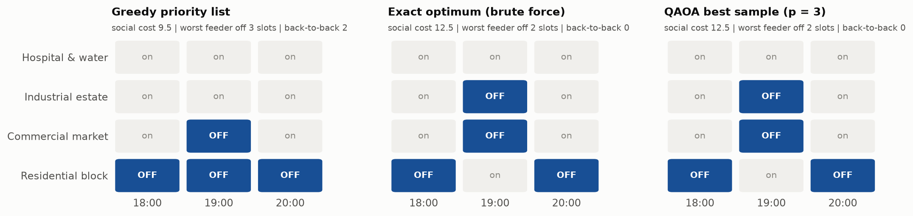
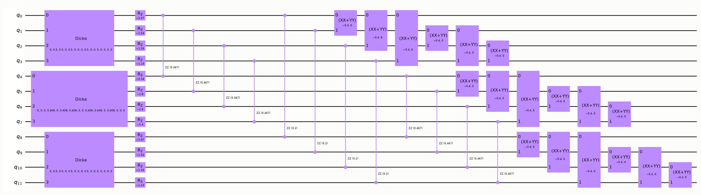
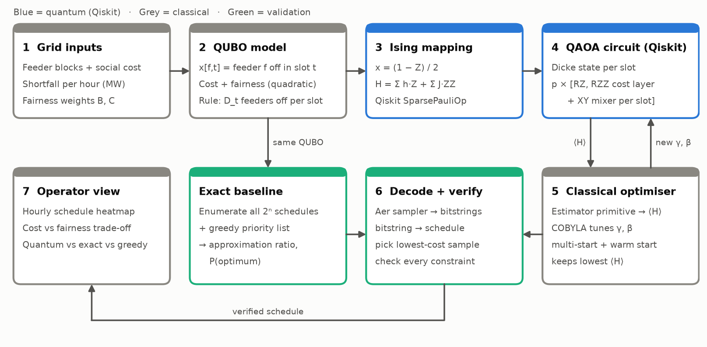
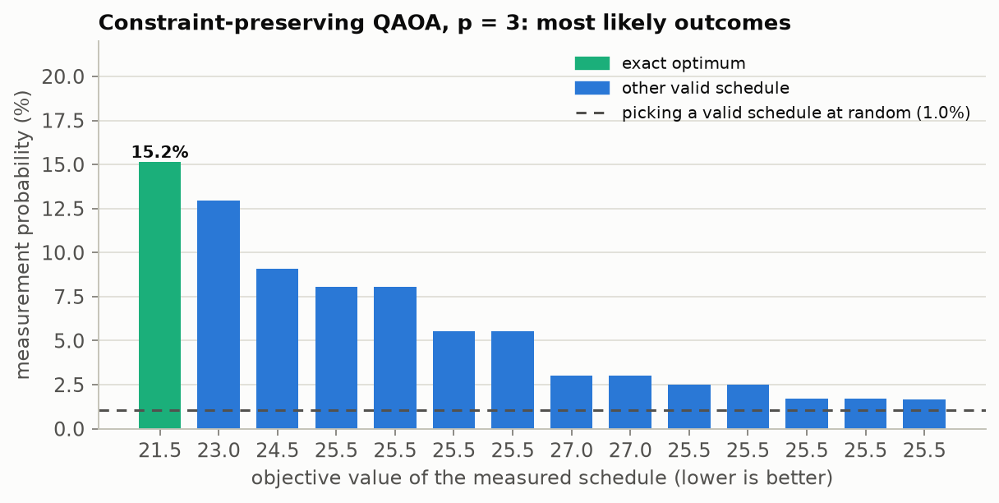
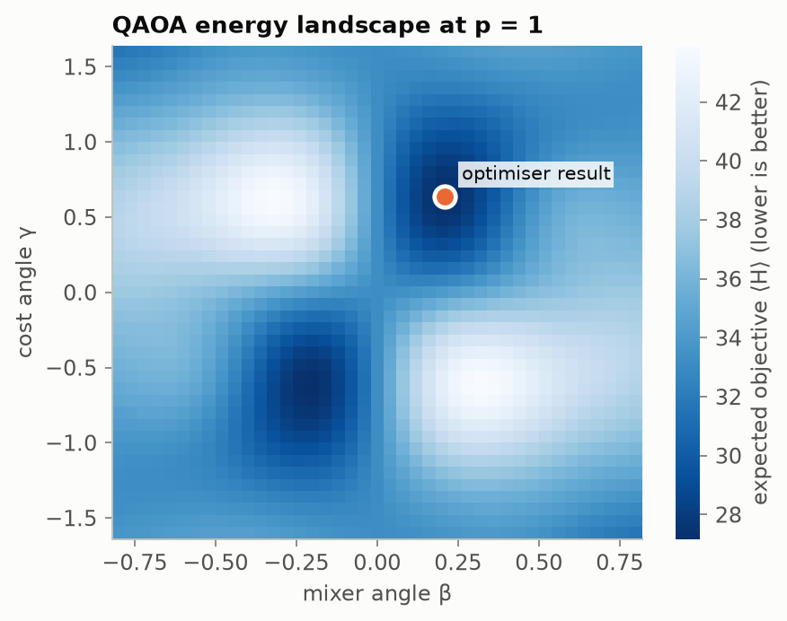
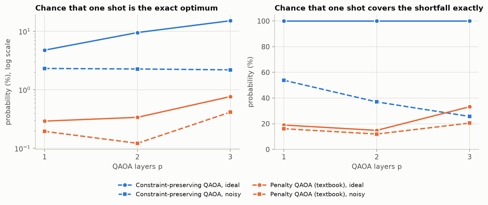
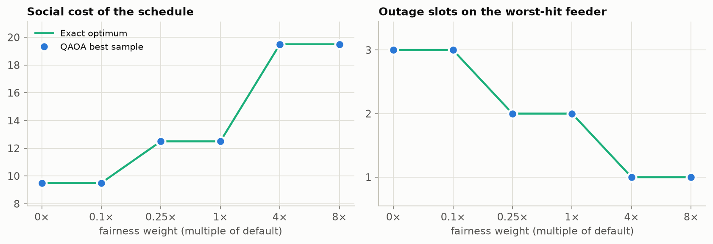

# ⚡ FairShed — a quantum scheduler for fair load shedding

**Qiskit Fall Fest 2026 Hackathon · Domain 6: Energy & Smart Infrastructure**

**Team Runtime Terrors:** Abdul Zakir (team lead), Muhammad Kashif, Huzefa Aslam

| Submission item | Link |
|---|---|
| Live app | [fairshed.streamlit.app](https://fairshed.streamlit.app) |
| 3-minute video pitch and demo | [Google Drive](https://drive.google.com/file/d/1GNZddvKO6-_PV2KvJzHGPbF4FQYLX6p4/view?usp=sharing) |
| Report (.docx, with architecture diagram, results and limitations) | [report/FairShed_Report.docx](report/FairShed_Report.docx) |
| Code | this repository |

When electricity supply falls short, a distribution company has to decide which
feeders go dark in which hour. A fixed priority list always cuts the same
neighbourhoods. FairShed formulates the decision as a quadratic binary
optimisation problem with two competing objectives — **low social cost** and
**fair sharing of outages** — and solves it with **QAOA in Qiskit**, verified
against an exact brute-force solver.



## Headline results

12 qubits (4 feeder blocks × 3 evening hours), 4,096 possible schedules, 96 of
which cover the shortfall exactly. Exact reference = brute-force enumeration.

| | Greedy priority list | Exact optimum (brute force) | **QAOA best sample** |
|---|---|---|---|
| Objective (lower is better) | 32.5 | 21.5 | **21.5** |
| Social cost | 9.5 | 12.5 | 12.5 |
| Worst-hit feeder: hours off | 3 | 2 | 2 |
| Back-to-back outages | 2 | 0 | 0 |

| At p = 3 layers | Chance one shot is the optimum | Shots that cover the shortfall | CX gates |
|---|---|---|---|
| **Constraint-preserving QAOA (ours)** | **15.2%** | **100%** | 213 |
| Penalty QAOA (textbook) | 0.77% | 33% | 180 |
| Picking a valid schedule at random | 1.04% | 100% | – |

On a larger 15-qubit instance (5 feeders, 32,768 schedules, 1,000 valid) the same
circuit measures the optimum 1.9% of the time at p = 2, against 0.10% for a
random valid guess.

- The best schedule measured from the quantum circuit **equals the exact optimum**.
- Building the hard "cover the shortfall" rule into the circuit (Dicke-state
  start + XY mixer) instead of penalising it makes the optimum **about 20×
  more likely** to be measured than with textbook penalty QAOA at the same depth.
- **We do not claim a quantum speedup.** At this size a laptop enumerates every
  schedule in milliseconds. See [Limitations](#limitations).

## The demo app

`streamlit run app.py` opens an interactive planner for a control-room operator:

- **Inputs:** an editable feeder table (name, social cost, hours already off today,
  protect flag), the shortfall for each hour, and a fairness level. Five ready-made
  scenarios are included.
- **Outputs:** an animated city view showing which districts go dark in each hour, the schedule grid, a plain-language outage notice, CSV/TXT downloads,
  a three-way comparison (priority list, exact optimum, QAOA), and the quantum
  details (measurement distribution, tuning curve, gate counts, circuit drawing).
- **Verification:** every plan is checked against the exact brute-force answer.

The quantum solver runs in a separate worker process (`fairshed/worker.py`) and
streams its progress to the page. Problems up to 15 qubits (feeders × hours) are
supported.

## The optimisation problem

Binary variable `x[f,t] = 1` if feeder block `f` is switched off in slot `t`.

```
minimise   Σ c_f · x[f,t]                        social cost of the outages
         + B · Σ x[f,t] · x[f,t+1]               back-to-back outages on one feeder
         + C · Σ_f ( h_f + Σ_t x[f,t] )²         outages concentrated on one feeder
         + A · Σ_t ( Σ_f P_f · x[f,t] − D_t )²   shortfall not covered exactly
```

`c_f` = social cost of one slot of outage, `P_f` = feeder load, `D_t` = shortfall
in slot `t`, `h_f` = slots feeder `f` was already off earlier today (0 by default). Every term is at most quadratic, so this is a QUBO with no slack
variables.

Test instance (`fairshed/instance.py`): hospital & water (cost 9), industrial
estate (5), commercial market (3.5), residential block (2), each 5 MW; shortfall
5 / 10 / 5 MW at 18:00 / 19:00 / 20:00; A = 12, B = 4, C = 1.5.

## The quantum algorithm

1. **QUBO → Ising.** `x = (1 − Z)/2` gives `H = Σ h·Z + Σ J·ZZ + const`, built by
   hand and stored as a Qiskit `SparsePauliOp`. A unit test checks that its
   diagonal equals the classical objective for all 4,096 bitstrings.
2. **QAOA circuit**, two encodings:
   - `penalty` — textbook QAOA: `|+⟩` start, RX mixer, all four terms in `H`.
   - `constrained` (main) — the hard rule is enforced by the circuit: each
     slot's qubits start in a **Dicke state** (all ways of switching off exactly
     `D_t` feeders) and the **XY mixer** only swaps a 1 and a 0 inside a slot, so
     every measured bitstring covers the shortfall. `H` keeps only cost and fairness.
3. **Hybrid loop.** COBYLA tunes the `2p` angles to minimise `⟨H⟩`, evaluated with
   the `StatevectorEstimator` primitive.
4. **Sample and decode.** The tuned circuit is measured on Qiskit Aer (with or
   without depolarizing noise); the lowest-cost valid bitstring is the schedule.



## Architecture



## Run it

Requires Python 3.10+ (developed on 3.14).

```bash
git clone https://github.com/abzakir/FairShed.git
cd FairShed
python -m venv .venv
.venv\Scripts\activate            # Windows   (macOS/Linux: source .venv/bin/activate)
pip install -r requirements.txt

python -m pytest -q               # 20 tests: 13 for the model, 7 end-to-end for the app
python run_experiments.py         # regenerates figures/ and results/results.json
streamlit run app.py              # interactive demo
```

`python run_experiments.py --quick` runs p = 1 only (about a minute). All random
seeds are fixed, so the numbers reproduce.

To rebuild the report: `npm install docx` then `node report/build_report.js`.

## Repository layout

```
fairshed/
  instance.py     problem data (feeders, shortfall, weights)
  qubo.py         QUBO matrix + term-by-term objective
  classical.py    exact brute force and greedy baseline
  quantum.py      QUBO→Ising, QAOA circuits, optimiser loop, Aer sampling, noise
  worker.py       solver process used by the app
  schedule.py     schedule table and outage notice
  analysis.py     metrics against the exact reference
  plots.py        figures
run_experiments.py   reproduces every number and figure
app.py               Streamlit demo
tests/               correctness tests
report/              report (.docx) and its generator
figures/, results/   generated outputs
```

## More results

| | |
|---|---|
|  |  |



With hardware-like noise the constraint-preserving circuit still measures the
optimum more often than penalty QAOA, but it loses its guarantee of valid
output, and extra layers stop helping: depth buys expressivity and costs fidelity.



Raising the fairness weight moves the optimal schedule from "cheapest" to
"evenly shared". At extreme values the model starts switching off the hospital
feeder to equalise the burden — the weights are a policy decision.

## Limitations

- **No quantum advantage.** Brute force solves this instance instantly and is
  how the answer is verified; classical integer-programming solvers handle
  realistic sizes.
- **Simulator only**, with a simple uniform depolarizing noise model and
  all-to-all connectivity.
- **The optimum is found by sampling.** The honest metric is the per-shot
  probability of the optimum, not "best of 1,024 shots", which random valid
  guessing would also achieve on a 96-state space.
- **Equal-size feeder blocks** are required by the constraint-preserving
  circuit. The QUBO supports unequal loads, but then only the weaker penalty
  encoding applies.
- **Noise breaks the hard constraint**; invalid shots must be discarded.
- **Dicke states** use Qiskit's generic `StatePreparation`, not the gate-optimal
  construction.
- **Simplified grid model.** Social costs and weights are illustrative, and
  network topology, ramping and minimum on/off times are ignored.
- **Scaling.** Qubits grow as feeders × slots; a real city is far beyond current
  devices.

## References

- Farhi, Goldstone, Gutmann — *A Quantum Approximate Optimization Algorithm*, arXiv:1411.4028
- Hadfield et al. — *From the QAOA to a Quantum Alternating Operator Ansatz*, arXiv:1709.03489
- Bärtschi, Eidenbenz — *Deterministic Preparation of Dicke States*, arXiv:1904.07358
- Wang, Rubin, Dominy, Rieffel — *XY mixers: analytical and numerical results for QAOA*, arXiv:1904.09314
- Koretsky et al. — *Adapting QAOA for Unit Commitment*, arXiv:2110.12624
